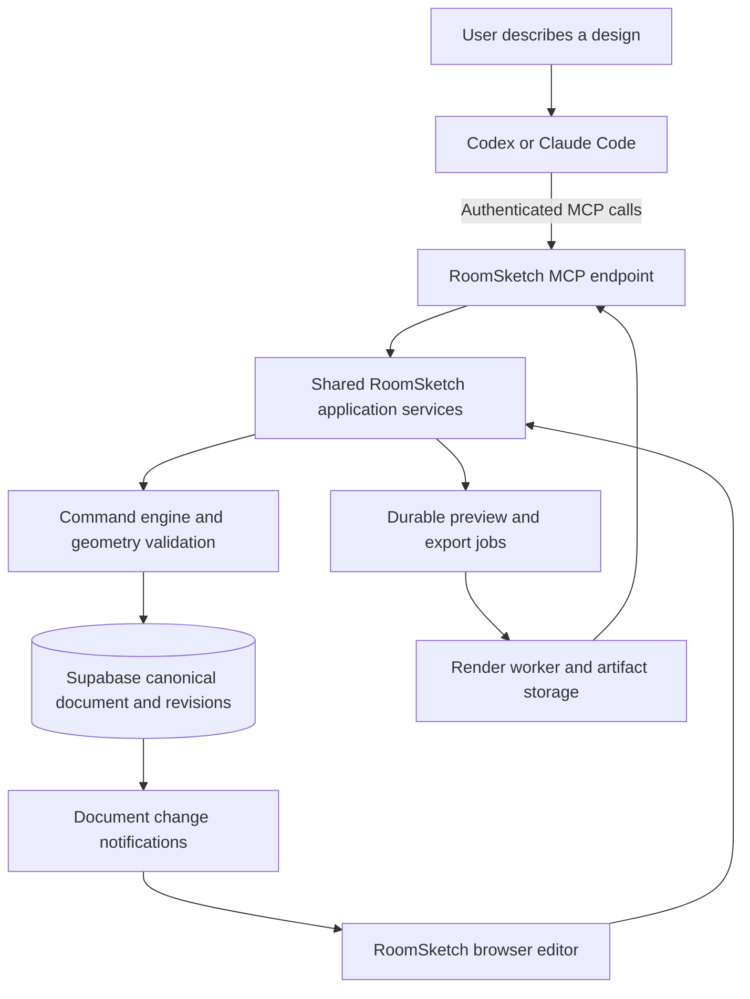

# RoomSketch MCP implementation plan

Planning baseline: November 19, 2026. This document proposes architecture and delivery work; it does not implement or deploy an MCP server.

## Product outcome

A RoomSketch user connects Codex, Claude Code, or another compatible MCP client, signs in to RoomSketch, and describes a house. The assistant creates and modifies a real, editable RoomSketch project, checks its geometry, inspects previews, and returns an authenticated editor link. The same project remains editable with the mouse.

MCP supplies the interface to the application. The user's assistant interprets the brief and decides which tools to call. RoomSketch supplies deterministic editing, geometry checks, persistence, previews, and permissions. A second LLM inside the MCP server is optional for future specialized generation, not required for the core workflow.

## Current repository findings

| Existing foundation | Evidence | Implication |
| --- | --- | --- |
| Next.js / TypeScript / Supabase | package.json | Start with the existing stack and the official TypeScript MCP SDK; verify the SDK release and client protocol compatibility when implementation starts. |
| Multi-floor editable document | components/workspace/lib/floor-data.ts | ProjectFloorPlan is the starting point for the canonical design document. |
| Detailed entity types | components/workspace/lib/constants.tsx | Rooms, wall nodes/segments, closed shapes, openings, furniture, stairs, lights, decor, outdoor objects, and saved views already exist. |
| Document update helpers | components/workspace/lib/project-document.ts | Reuse and extend pure operations, including dimension locks and floor elevation handling. |
| Browser state owner | components/workspace/hooks/useProjectDocument.ts | Browser changes must eventually use the same command semantics as remote changes. |
| Revision-guarded save | app/api/workspace/floorplan-editor-state/route.ts | Reuse compare-and-swap behavior; every design write path must participate. |
| Derived 3D scene conversion | lib/workspace/floorPlanConvertor.ts | Regenerate scene_json from the canonical document rather than maintaining an independent agent-authored scene. |
| Measurements and comparisons | components/workspace/lib/practical-features.ts | Reuse area calculations and document comparisons in inspection and change summaries. |
| Project, sharing, review endpoints | app/api/projects; app/api/workspace/share; app/api/workspace/reviews | Extract shared services where suitable; current cookie-authenticated routes are not themselves an MCP authorization layer. |
| Export helpers | components/workspace/lib/export | Inventory each helper's browser dependencies. The 3D exporter uses the mounted Three.js graph, so remote export needs additional rendering work. |
| Entitlements | lib/entitlements.ts | Apply existing project limits and feature gates consistently to MCP operations. |
| ChatGPT account linking | app/api/chatgpt/connect; app/api/chatgpt/callback | These routes make RoomSketch an OAuth client of an external identity provider. They do not authorize external MCP clients to act on RoomSketch projects. |

This is a focused architecture inspection, not an exhaustive feature or security audit. Existing working-tree edits were left untouched.

## Architecture



Expose a hosted HTTPS Streamable HTTP endpoint, with `/api/mcp` as the initial route proposal. One multi-tenant service handles all users. Projects and users must never live in global mutable MCP session state: authorization context belongs to each request, and commands name their project and floor explicitly.

Keep MCP handlers thin: parse typed inputs, authenticate, authorize the project and scope, call the shared service, and return a typed result. Do not route agent operations through synthetic mouse events or implement separate geometry logic in every MCP handler.

Start with short request handlers in the existing Node runtime. Preview, rendering, import processing, and heavy exports run through durable jobs and a worker, not in-memory promises in a web request. Check actual hosting limits before choosing the worker deployment. The browser does not have to be open to edit or save a project.

Use the official SDK's supported protocol negotiation and transport implementation. Pin and test a compatibility matrix for actual Codex and Claude Code versions; avoid hand-coding transport assumptions from a different MCP revision.

## Connection and authorization

1. A user adds the hosted RoomSketch MCP URL to their client.
2. The client discovers the authorization server through protected-resource metadata.
3. The browser opens RoomSketch sign-in and a consent screen identifying the client, permissions, and project access.
4. An OAuth authorization-code flow with PKCE issues scoped access to the MCP resource.
5. Each tool request verifies the access token, issuer, audience/resource, expiry, scope, and current project permission.
6. RoomSketch Settings lists connected clients and allows revocation. Revocation must invalidate grants and active access through a defined enforcement mechanism, not just remove the settings row.

Use an established MCP-compatible authorization provider rather than building OAuth cryptography. Evaluate whether the configured Supabase authorization offering supplies the required discovery, client registration, grant revocation, and resource handling; ordinary Supabase browser login is insufficient evidence. Support registration methods compatible with both target clients, including pre-registration as a fallback.

Proposed scopes: `projects:read`, `projects:write`, `assets:read`, `exports:create`, and `sharing:write`. Project restrictions are stored grant permissions and checked server-side. Do not accept an asserted user_id from tool arguments. Prefer user-context database access with RLS; if a trusted service uses elevated database access, explicitly enforce the same project authorization there.

A private development pilot can use separately issued, hashed, expiring, revocable scoped access tokens. It must not distribute service-role keys or browser session cookies. Public self-service onboarding uses OAuth.

## Canonical document and editing model

Use a versioned design document containing ProjectFloorPlan and the persistent SceneConfig fields needed to reproduce the design. Explicitly distinguish persistent design/view settings from per-user ephemeral selection, active tools, and camera navigation. Derived scene_json and workspace_config are regenerated through existing converters when the relevant design changes.

Extract browser-independent types and pure editing functions from component-oriented modules into `lib/design`. Keep React, DOM access, texture loading, and interactive rendering outside this domain layer. Add runtime schema validation; TypeScript types alone do not validate remote arguments.

Define a consistent coordinate contract: metres internally, documented X/Z floor plane, vertical elevation, documented origin and rotation convention. Convert feet or other user-facing units at the boundary. Distinguish declared north orientation from coordinate axes. Retain server-issued stable entity IDs and map room boundaries to their underlying wall representation.

Semantic commands include create_room, resize_room, move_wall, add_opening, place_asset, assign_material, add_floor, configure_stairs, and configure_roof. Resolve shared walls and openings centrally; creating adjacent rooms must not create conflicting duplicate wall geometry. Moving or splitting a wall must update or reject dependent openings and references.

Each operation batch includes project_id, base_revision, idempotency_key, and typed operations. The whole batch succeeds or fails atomically. A database transaction commits the document, derived state, revision/history, and operation receipt together. A unique operation key plus payload hash prevents retries from duplicating rooms or charging twice. Scope keys to the authenticated tenant/project and reject a key reused for a different payload.

The existing revision string can remain an opaque revision identifier. Do not replace it with an unrelated revision scheme without a migration reason. Audit all other design-save routes and bring them under the same concurrency contract.

## Proposed MCP surface

These names are a proposed API, not existing server capabilities. Start with a compact set of discoverable tools, grouping coherent edits into typed batches instead of exposing every UI button.

| Tool | Purpose | Delivery |
| --- | --- | --- |
| get_capabilities | Supported operations, schema version, unit conventions, formats, and effective entitlements | First release |
| list_projects | Paginated accessible projects and short summaries | First release |
| get_project | Revision, floors, room/entity summaries; optional floor/entity filtering | First release |
| create_project | Create a blank project or a supported template using existing project limits | First release |
| search_catalog | Search supported furniture/materials with valid IDs, dimensions, and placement constraints | First release |
| preview_changes | Apply a typed batch in memory, validate, and return a diff and diagnostics without saving | First release |
| apply_changes | Validate and atomically commit a typed batch against a required base revision | First release |
| validate_project | Geometry diagnostics and later optional rule profiles | First release |
| get_preview | Revision-bound 2D preview initially; asynchronous 3D views later | First release / expansion |
| list_revisions / restore_revision | Inspect history and restore a prior design as a new revision | Expansion |
| export_project / get_job | Request exports and retrieve persistent job status/results | Expansion |
| manage_share_link | Create, expire, or revoke a link with explicit sharing permission | Expansion |
| list_reviews / add_review / resolve_review | Use the existing review model with authorized access | Expansion |

Every preview or artifact identifies its source revision. Job results include status, source revision, expiry, and a permission-checked artifact reference or short-lived signed URL. A stale thumbnail is never reported as a fresh preview.

Resources can expose unit conventions, schema documentation, material/catalog references, and revision-bound project summaries, for example `roomsketch://projects/{id}/revisions/{revision}/summary`. Recheck authorization when reading resources. Prompts can supply guided briefs such as design_house or furnish_room. Core actions and essential context must also be available through tools because client support and resource/prompt workflows vary.

Use clear tool descriptions and accurate read-only, destructive, and idempotence annotations where supported. Annotations assist clients; server authorization remains authoritative. Avoid arbitrary SQL, arbitrary JavaScript execution, or an unrestricted raw document replacement tool.

## Feature coverage and delivery order

| Feature family | Required operation support | Key acceptance condition |
| --- | --- | --- |
| Projects and templates | Create, list, inspect, rename, duplicate | Correct ownership and plan limits |
| Walls and rooms | Rectangular/polygon rooms, node/segment edits, wall type/thickness/height, room labels | Shared walls, closed geometry, stable references |
| Doors and windows | Place, resize, move, style, remove | Valid host wall and offsets; fit within wall |
| Furniture | Search, place, move, rotate, duplicate, remove | Catalog IDs, footprints, collisions and containment |
| Materials | Apply to room floor, wall faces, openings, furniture | Material domain compatibility |
| Floors and stairs | Add/reorder/rename floors, elevations, connections, voids and guards | Consistent elevations and dependent references |
| Roof and outdoors | Existing roof options, outdoor catalog placement | Supported parameters and valid target geometry |
| Lights and views | Light placement, persistent scene settings, saved views | Documented units and reproducible previews |
| Measurements and constraints | Areas, dimensions, locks, layout diagnostics | Deterministic measurements and respected locks |
| History and alternatives | Duplicate alternatives, compare, list/restore revisions | Restore does not erase subsequent history |
| Export | Inventory SVG/DXF/PDF/CSV/glTF/OBJ paths and expose verified server-capable formats | Matches source revision; existing entitlement enforced |
| Sharing and reviews | Links, revocation, review threads | No sharing as a side effect of ordinary editing |
| Tracing/import | Controlled upload, scale calibration, supported conversions | Supported formats, bounded sizes, user-confirmed scale when unknown |

Do not advertise an operation until it is implemented and tested. Optional future workflows include constraint-based whole-house generation, ranked alternatives, regional rule profiles, and external asset imports. Exposing MCP does not itself solve architectural layout optimization or certify a design against building regulations.

## What an end-to-end request looks like

User: “Design a three-bedroom house on a 30 by 40 foot plot with an open kitchen and a parking space.”

The assistant obtains missing constraints that materially affect the design, such as road/front direction, floor count, and whether dimensions describe the plot or building envelope. It records provisional assumptions instead of silently claiming to know setbacks or local requirements.

It reads capabilities and catalog entries, creates a project, and proposes a batch of room/wall/opening/asset operations. RoomSketch validates the batch and returns stable IDs, dimensions, and fixable diagnostics. The assistant repairs invalid geometry, commits the valid batch, requests a preview, and uses the result to assess the layout. It returns a private editor link with a short description of the design and assumptions.

Follow-up: “Make the kitchen two feet wider.” The assistant reads the latest revision and kitchen entity, requests a semantic resize, inspects affected adjacent rooms/openings, validates, and commits against that revision. A conflict produces a structured revision_conflict error and requires a fresh read and replanning; no blind overwrite.

## Synchronizing the browser

Database saves alone do not update an already-open editor. Add project-scoped change notifications through a suitable supported channel, such as Supabase Realtime or an application event service. Validate delivery permissions and reconnect behavior.

When the browser is clean, load the new canonical revision and regenerate its local view. When it has unsaved edits, retain them and show a remote-change conflict state. Do not silently replace local state. MVP can use refresh/reload with explicit conflict handling; seamless concurrent editing needs a separate merging design.

Browser undo and server revision history have distinct semantics. Initially treat a remote batch as a named history event and provide revision restore. Do not let an old browser undo stack resave over newer remote work without a revision check.

## Preview, export, and long-running work

Start with a server-generated 2D SVG from the canonical document and a usable project link. Verify the existing flattening/export path is server-safe or extract a pure serializer. Optional raster previews can be generated from the SVG for clients that support image content but not SVG display.

For 3D, use a controlled render worker loading the canonical revision and the same scene components/assets. The existing 3D exporter depends on a mounted Three.js scene; wrapping its function in a tool is insufficient. Return a job_id and expose polling as a portable baseline. Add progress or protocol task features only after testing client support. Record cancellation, failures, retries, and artifact cleanup durably.

Apply feature gates and atomic quota accounting before expensive work. Return a cost/credit estimate when applicable, enforce per-request bounds, and charge each idempotent job at most once. Ordinary geometry tools should not trigger paid generative services implicitly.

## Suggested code organization

```text
lib/design/                 canonical schemas, commands, geometry, validation
lib/projects/               authorized loading, transactional saves, revisions
lib/mcp/                    server registration, tools, resources, result mapping
lib/integrations/           authenticated principals, scopes, grants
lib/jobs/                   durable preview/export requests and status
app/api/mcp/route.ts         transport adapter, subject to host compatibility
supabase/migrations/        revision history, operation receipts, grants/jobs as needed
workers/render/             isolated rendering/export execution
```

Authorization discovery endpoints depend on the selected provider. Do not create a parallel identity system merely to follow this directory proposal.

## Implementation phases and release gates

1. **Domain foundation.** Extract canonical types, add runtime schemas and the shared command engine; migrate existing saves to one revision-aware service. Gate: browser edits and service commands produce equivalent canonical/derived documents; invalid batches leave no partial state.
2. **Private vertical slice.** Hosted MCP with scoped pilot credentials, project read/create, catalog search, room/opening/furniture commands, validation, and 2D preview. Gate: both clients create a furnished editable project and perform a follow-up resize while the browser is closed.
3. **Public connection.** OAuth discovery/consent, compatible client registration, project grants, connection/revocation settings, rate limits, audit records, and entitlement enforcement. Gate: fresh-user onboarding works in both clients; cross-user access and revoked grants fail.
4. **Reliable ongoing editing.** Remote-change UI, history/restore, broader shape/material operations, retries and reconnection. Gate: browser-versus-agent and agent-versus-agent races cannot silently lose edits; retried requests cannot duplicate effects.
5. **Feature expansion.** Multi-floor/stairs/roof/outdoor/light operations, background 3D previews and exports, sharing and reviews, calibrated imports. Gate: each advertised feature passes semantic, persistence, permission, and preview checks.
6. **Design quality.** Representative prompt evaluation, template/constraint planning, alternatives and scoring. Gate: measured improvement in valid, editable layouts, rather than only a higher tool-call success rate.

Public launch requires phases 1–4. Phase 5 can ship in increments with capabilities advertising actual availability. Estimate implementation duration after the domain extraction and authorization-provider spike; these are the principal unknowns.

## Verification and operational measures

- Meaningful domain tests: shared-wall adjacency, wall splits and attached openings, dimension locks, invalid polygons, floor elevation changes, and failed-batch rollback.
- Persistence tests: revision conflicts through every save path, idempotent retry after a dropped response, atomic operation receipts/history, and preservation of derived state.
- Authorization tests: another user's project, project-restricted grant, insufficient scope, expired token, revoked grant, resource reads, signed artifacts, and job ownership.
- Client integration: tool discovery and schemas, OAuth callbacks, image/link results, reconnect and error recovery in supported Codex and Claude Code versions.
- End-to-end design evaluation: rectangular house, polygon rooms, tight furnishing, ambiguous units, multi-floor stairs, follow-up edits, and conflicting browser edits. Assess actual editable geometry and previews.
- Observability: request and operation IDs, latency, validation failure categories, conflict rate, job failure rate, and time to first valid editable design. Avoid logging tokens or unnecessary home-plan content.

Return machine-readable errors such as revision_conflict, invalid_geometry, unsupported_asset, insufficient_scope, and quota_exceeded, with entity IDs and actionable diagnostics. Distinguish permission or transport failures from tool execution failures using the SDK's appropriate error/result mechanisms.

## Sources checked

- MCP architecture: https://modelcontextprotocol.io/docs/concepts/architecture
- MCP official SDKs: https://modelcontextprotocol.io/docs/sdk
- MCP authorization: https://modelcontextprotocol.io/specification/latest/basic/authorization
- Codex MCP support/setup: https://developers.openai.com/codex/mcp
- Claude Code MCP support/setup: https://code.claude.com/docs/en/mcp

Consult current versions again when implementing; do not treat this planning document as a frozen protocol specification.
